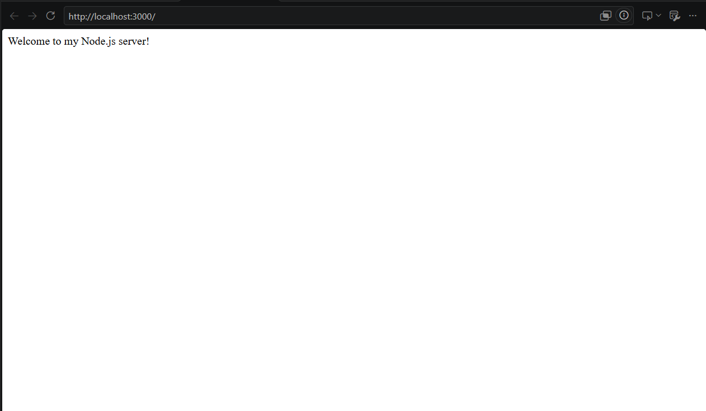
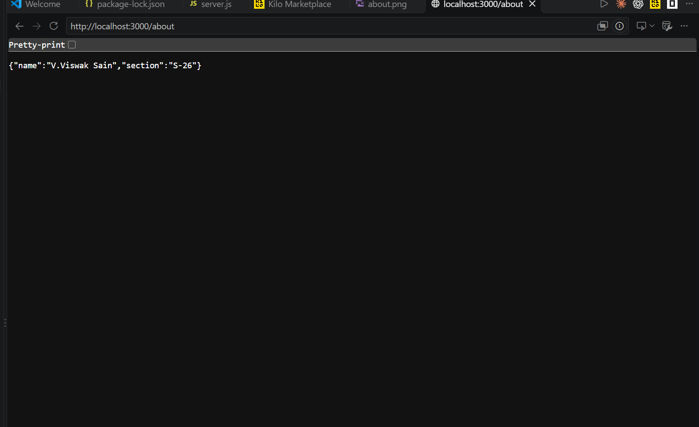
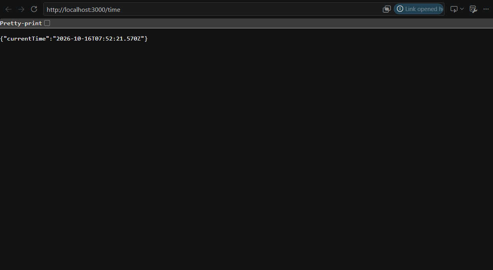
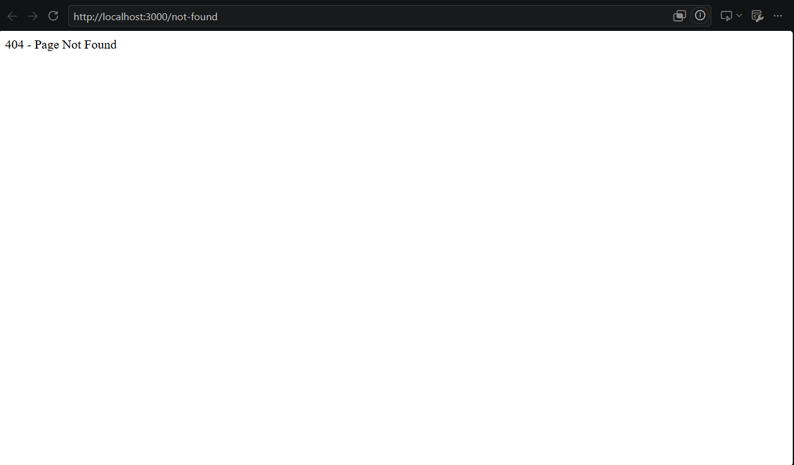

# Lab 1: Node.js and Express Server

## Student information

- Name: V.Viswak Sain
- Registration number:252U1R9171
- Section: CSE-GEN-AI-2C (S-26) 
- Course: Backend Development Fundamentals
- Lab Number: 01
## Deployment

- Live deployment URL: https://lab-report-backend-viswak.vercel.app/

## Project objective

Build a small web server using Node.js and Express. The server responds to three known GET routes, returns the current date and time, and sends a 404 response for unknown routes.

## Prerequisites

- Node.js and npm installed on your computer. npm is included with Node.js.
- A web browser.
- A terminal such as PowerShell, Command Prompt, or the VS Code integrated terminal.
- Git and a GitHub account for submission.

To check that Node.js and npm are available, run:

```powershell
node --version
npm --version
```

## Install and run

Open a terminal in this `lab-01` folder. If your terminal starts in the parent project folder, change to the lab folder first:

```powershell
cd "lab-01"
```

Install the dependencies listed in `package.json` and `package-lock.json`:

```powershell
npm install
```

Start the server:

```powershell
npm start
```

The terminal should print the local server address. Keep this terminal open while testing; press **Ctrl+C** in it when you want to stop the server.

If port 3000 is already in use, either stop the other server or choose another port in PowerShell before starting this app:

```powershell
$env:PORT = "3001"
npm start
```

Use `http://localhost:3001` for testing in that case. The environment variable applies only to that PowerShell session.

## Endpoints

| HTTP method | URL path | Description | Expected status |
|---|---|---|---:|
| GET | `/` | Displays a welcome message. | 200 |
| GET | `/about` | Returns the student name and section as JSON. | 200 |
| GET | `/time` | Returns the current date and time as JSON. | 200 |
| GET | Any unknown path, such as `/not-found` | Displays a not-found message. | 404 |

## Test in a browser

With the server running, open each URL in your browser:

- <http://localhost:3000/>
- <http://localhost:3000/about>
- <http://localhost:3000/time>
- <http://localhost:3000/not-found>

The first three URLs should return the results described in the endpoint table. The last URL deliberately uses an unknown path and should return the 404 message. If you configured a different port, replace `3000` with that port.

## Check HTTP status codes in Chrome Developer Tools

1. Open one of the endpoint URLs in Chrome.
2. Open Developer Tools with **F12** or **Ctrl+Shift+I**.
3. Select the **Network** tab. If needed, reload the page while the tab is open.
4. Select the request for the page (often shown as `localhost` or the requested path).
5. Find **Status Code** in the **Headers** pane. Confirm `200` for the three valid routes and `404` for `/not-found`.

## Screenshots

The screenshots in this folder were supplied by the student and show the browser responses as captured. They are included as evidence; the 404 screenshot shows the page response but not its HTTP status code in Developer Tools.

1. The submitted screenshots below are actual browser captures from the student.
2. For evidence of a status code, capture Chrome with the request selected in **Network** and its **Status Code** visible in **Headers**.
3. Save any additional screenshots you capture in this folder.
4. The submitted home-page, about-route, time-route, and not-found screenshots are saved in the folder:

- Home page: 
- About page: 
- Time page: 
- 404 response: 


The app uses `process.env.PORT` when a hosting provider supplies it and falls back to port 3000 for local use. This project has not been deployed by these instructions.

## Notes: problems faced and solutions

Record any issues you encounter and how you resolved them. For example:

- Problem: There was an problem in deployment in render
- Solution: changed the provider to vercel now its running fine
