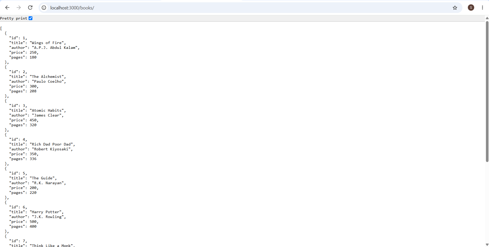
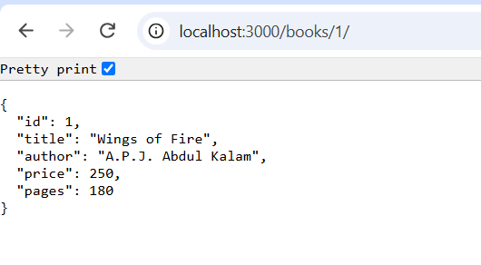
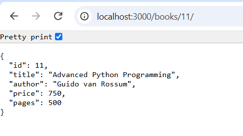
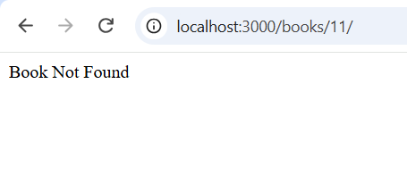

# Lab 2: SQLite Database and CRUD Routes

## Student Details

* **Name:** Viswak Sain Vuppala
* **Registration Number:** 252U1R9171
* **Section:** CSE-GAI-2C

## GitHub Repository

**Repository:** https://github.com/viswaksain-vuppala/Lab_Reports_Backend/tree/main/Lab_Report_02

## Live Deployment

**Live Link:** https://bdflabreport02-viswak.vercel.app/

## Objective

The objective of this lab is to connect an Express.js server with an SQLite database and perform CRUD operations through HTTP routes.

## Technologies Used

* Node.js
* Express.js
* SQLite
* sqlite3
* sqlite
* Nodemon
* JavaScript

## Project Structure

```text
lab-02/
│
├── screenshots/
│   ├── get-all-books.png
│   ├── get-book-by-id.png
│   ├── post-add-book.png
│   ├── put-update-book.png
│   └── delete-book.png
│
├── node_modules/
├── bookStore.db
├── package.json
├── package-lock.json
├── server.js
└── README.md
```

## Database Details

**Database Name:** bookStore.db

**Table Name:** book

The book table contains the following columns:

| Column | Data Type           |
| ------ | ------------------- |
| id     | INTEGER PRIMARY KEY |
| title  | TEXT                |
| author | TEXT                |
| price  | INTEGER             |
| pages  | INTEGER             |

Initially, I inserted 10 book records into the database using SQLite.

## Installation and Execution

### 1. Install dependencies

```bash
npm install
```

### 2. Start the server

```bash
npm start
```

### 3. Server URL

```text
http://localhost:3000
```

The server connects to the SQLite database before starting.

## API Endpoints

### 1. GET - Retrieve All Books

* **Method:** GET
* **Endpoint:** `/books/`
* **Description:** Retrieves all book records from the database.

**Screenshot:**



### 2. GET - Retrieve a Specific Book

* **Method:** GET
* **Endpoint:** `/books/:bookId/`
* **Description:** Retrieves the details of a particular book using its ID.

**Screenshot:**


### 3. POST - Add a New Book

* **Method:** POST
* **Endpoint:** `/books/`
* **Description:** Adds a new book to the database.

**Request Body:**

```json
{
    "title": "Python Programming",
    "author": "Guido van Rossum",
    "price": 600,
    "pages": 450
}
```

**Screenshot:**



### 4. PUT - Update a Book

* **Method:** PUT
* **Endpoint:** `/books/:bookId/`
* **Description:** Updates the details of an existing book using its ID.

**Screenshot:**



### 5. DELETE - Delete a Book

* **Method:** DELETE
* **Endpoint:** `/books/:bookId/`
* **Description:** Deletes a particular book from the database using its ID.

**Screenshot:**



## SQL Query Parameterization

I used `?` placeholders in SQL queries that accept user input. This helps prevent SQL injection and makes database operations safer.

## Testing and Verification

I tested all five API endpoints successfully.

* GET requests retrieved the required book details.
* POST successfully inserted a new book.
* PUT successfully updated an existing book.
* DELETE successfully removed a book.
* I verified the database after the operations. It contained the original 10 records after deletion.

I used PowerShell commands and a web browser to test the APIs instead of Postman.

## Conclusion

Through this lab, I learned how to connect an Express.js application with an SQLite database and perform CRUD operations using HTTP methods. I also understood the importance of asynchronous database connections and parameterized SQL queries.
