# LAB 3: REST API, QUERY PARAMETERS, VALIDATION AND DEBUGGING

**Subject:** Backend Development Fundamentals  
**Year:** II  
**Term:** II  
**Module:** RESTful API Development and Validation

---

## 1. Student Details

| Field | Details |
|---|---|
| Student Name | Viswak Sain Vuppala |
| Registration Number | 252U1R9171 |
| Section | CSE-GAI-2C |
| Lab Number | 03 |
| Lab Title | REST API, Query Parameters, Validation and Debugging |

---

## 2. Objective

To develop a clean REST API using Node.js, Express.js and SQLite by implementing CRUD operations, query parameters, search, sorting, pagination, price-range filtering, input validation and proper HTTP status codes.

The lab also focuses on identifying and resolving common backend development errors through debugging exercises.

---

## 3. Technologies Used

- Node.js – JavaScript runtime environment.
- Express.js – Backend web framework.
- SQLite – Relational database.
- JavaScript – Programming language.
- Nodemon – Automatic server restarting during development.
- Visual Studio Code – Development environment.

---

## 4. Project Structure

```text
lab-03/
│
├── screenshots/
│   ├── add-book.png
│   ├── delete-book.png
│   ├── deleted-book-404.png
│   ├── get-all-books.png
│   ├── get-book-by-id.png
│   ├── invalid-price-400.png
│   ├── invalid-sorting.png
│   ├── missing-author-400.png
│   ├── missing-book-404.png
│   ├── multiple-books.png
│   ├── pagination.png
│   ├── price-filter.png
│   ├── project-structure.png
│   ├── search-books.png
│   ├── sorting-books.png
│   ├── sorting-descending.png
│   └── update-book.png
│
├── .gitignore
├── db.js
├── package.json
├── package-lock.json
├── README.md
└── server.js
```

The `node_modules/` directory and SQLite database file are excluded from Git tracking.

---

## 5. Installation and Execution

### Prerequisites

- Node.js
- npm
- Visual Studio Code

### Step 1: Install Dependencies

```bash
npm install
```

### Step 2: Start the Application

```bash
npm run dev
```

### Step 3: Access the Application

```text
http://localhost:3000/
```

### Environment Variables

No environment variables are required for the current local implementation.

---

## 6. Database Design

**Database:** SQLite  
**Database File:** `books.db`  
**Table Name:** `book`

### Book Table Structure

| Column | Data Type | Description |
|---|---|---|
| id | INTEGER | Primary key with auto increment |
| title | TEXT | Name of the book |
| author | TEXT | Author of the book |
| price | INTEGER | Price of the book |
| pages | INTEGER | Number of pages |

---

## 7. API Endpoints

The application follows RESTful naming conventions by using nouns for endpoints and HTTP methods to identify operations.

| HTTP Method | Endpoint | Description |
|---|---|---|
| GET | `/books/` | Retrieve all books |
| GET | `/books/:bookId/` | Retrieve a specific book |
| POST | `/books/` | Add a new book |
| PUT | `/books/:bookId/` | Update an existing book |
| DELETE | `/books/:bookId/` | Delete a book |

---

## 8. Query Parameters

The GET `/books/` endpoint supports the following query parameters.

| Parameter | Default Value | Description |
|---|---|---|
| search_q | Empty string | Searches books using partial title matching |
| order_by | id | Specifies the column used for sorting |
| order | ASC | Specifies ascending or descending order |
| limit | 10 | Specifies the maximum number of records |
| offset | 0 | Specifies the number of records to skip |
| min_price | Not applied | Specifies the minimum price |
| max_price | Not applied | Specifies the maximum price |

### Example Requests

**Search by Title**

```text
/books/?search_q=Alchemist
```

**Ascending Sorting**

```text
/books/?order_by=price&order=ASC
```

**Descending Sorting**

```text
/books/?order_by=price&order=DESC
```

**Pagination**

```text
/books/?limit=5&offset=0
```

**Price Range Filtering**

```text
/books/?min_price=200&max_price=500
```

---

## 9. Request Body

The following JSON format is used when adding or updating a book.

```json
{
  "title": "The Alchemist",
  "author": "Paulo Coelho",
  "price": 350,
  "pages": 208
}
```

---

## 10. Input Validation and Error Handling

The application implements validation to ensure that incoming requests contain appropriate values.

### Validation Rules

1. Title must not be missing or empty.
2. Author must not be missing or empty.
3. Price must be a valid number.
4. Sorting columns must belong to the permitted column list.
5. Sorting order must be either ASC or DESC.
6. Limit must be a positive integer.
7. Offset must be a non-negative integer.
8. Minimum price must not exceed maximum price.

### HTTP Status Codes

| Status Code | Description |
|---|---|
| 200 OK | Request completed successfully |
| 201 Created | Book created successfully |
| 400 Bad Request | Invalid input or query parameter |
| 404 Not Found | Requested book does not exist |
| 500 Internal Server Error | Unexpected server error |

Error responses use a consistent JSON message format.

Example:

```json
{
  "message": "Book not found"
}
```

---

## 11. API Testing

The API endpoints were tested using PowerShell HTTP requests and browser-based GET requests.

### Testing Categories

- Retrieving all book records.
- Retrieving an individual book.
- Adding new books.
- Updating existing books.
- Deleting books.
- Searching books by title.
- Sorting records in ascending and descending order.
- Applying pagination.
- Filtering books using a price range.
- Testing missing title and author.
- Testing invalid price values.
- Testing invalid sorting parameters.
- Testing non-existent book IDs.

The testing process covered both successful requests and failure cases.

---

## 12. Screenshots and Output

### 12.1 CRUD Operations

**1. Add Book**

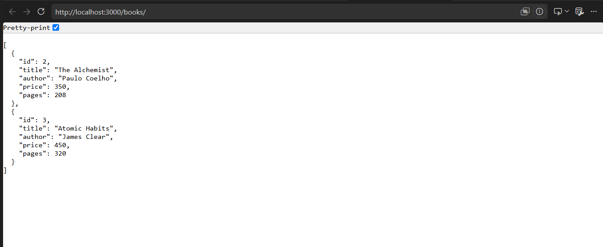

**2. Retrieve All Books**

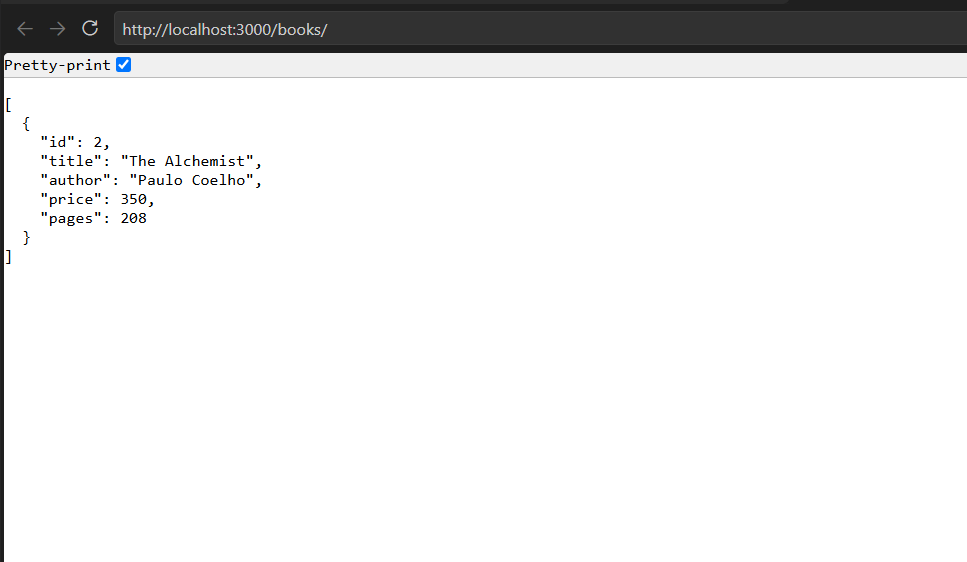

**3. Retrieve Book by ID**

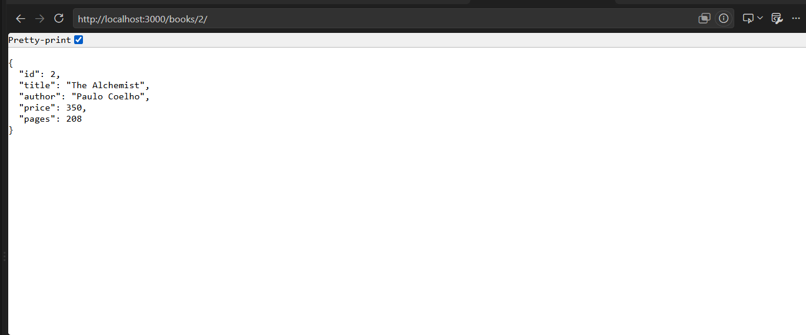

**4. Update Book**

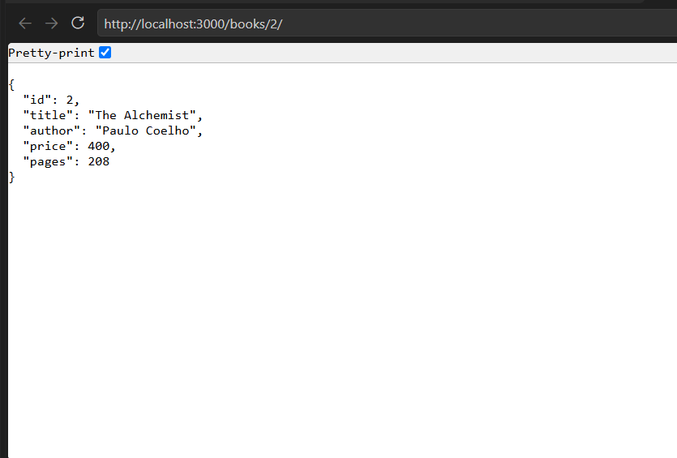

**5. Delete Book**


**6. Verify Deleted Book – 404**

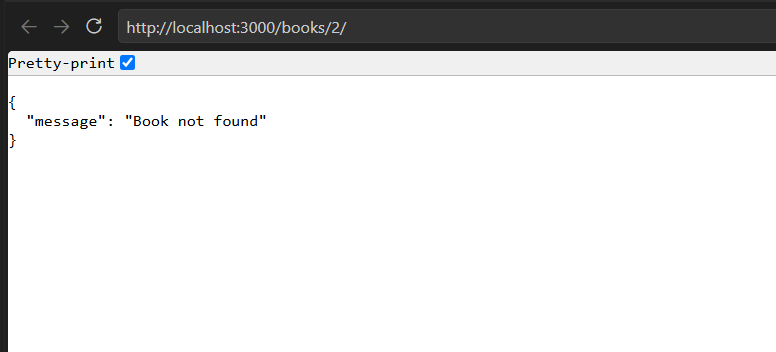

### 12.2 Query Parameter Operations

**7. Search Books**

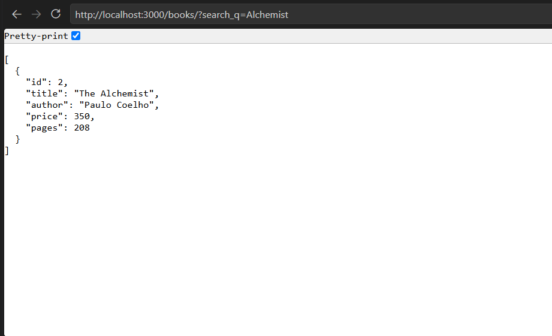

**8. Price Range Filtering**

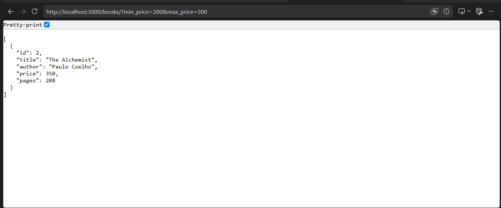

**9. Ascending Sorting**

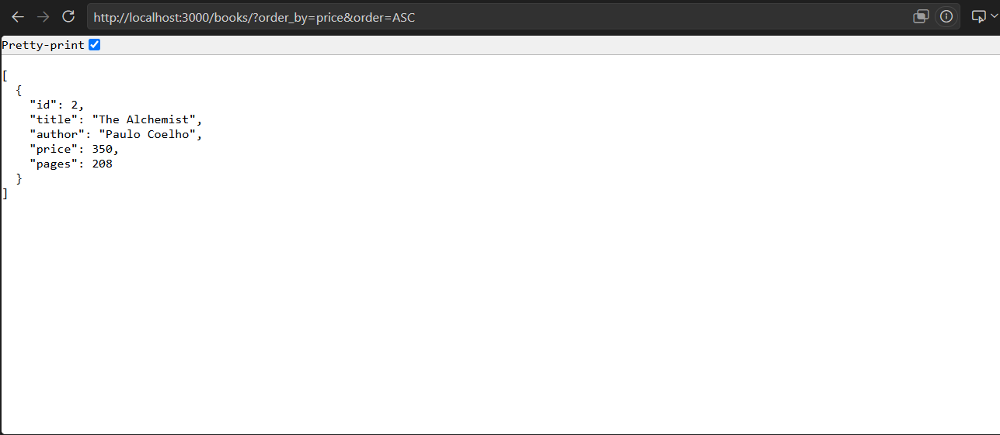

**10. Descending Sorting**

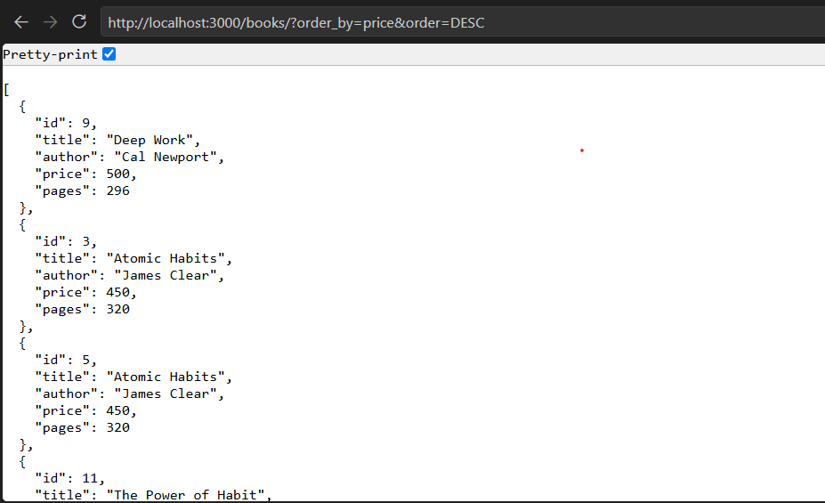

**11. Pagination**

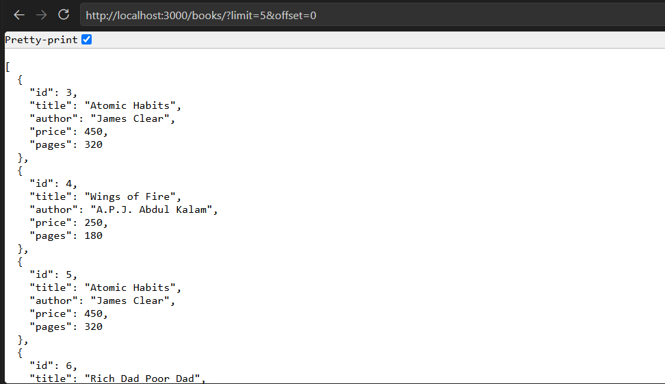

### 12.3 Validation and Error Handling

**12. Missing Author Validation**

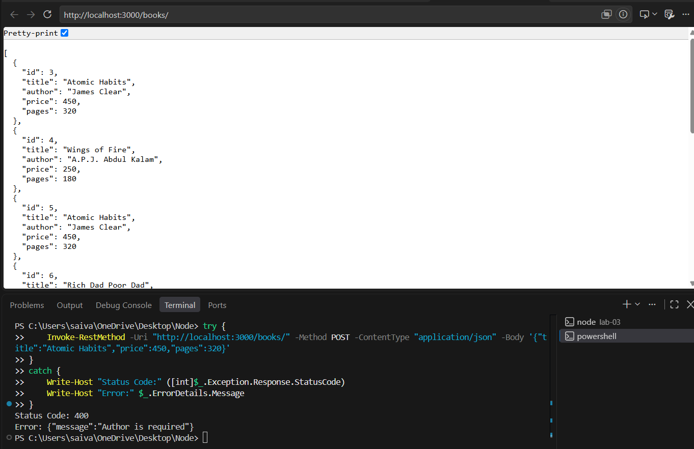

**13. Invalid Price Validation**

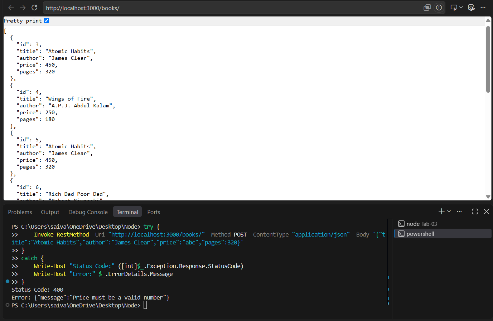

**14. Invalid Sorting Parameter**

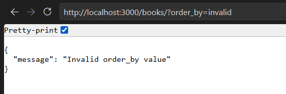

**15. Non-existent Book – 404**

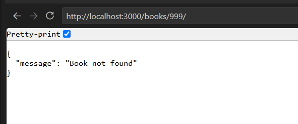

### 12.4 Database and Project Evidence

**16. Multiple Book Records**

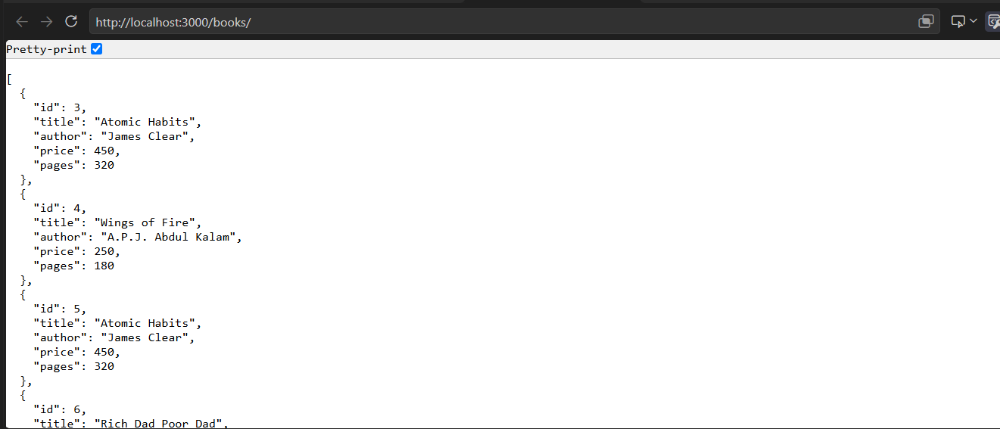

**17. Project Structure**

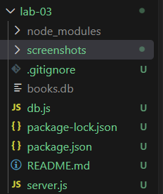

---

## 13. Debugging Exercises

### 1. Port Conflict – EADDRINUSE

**Problem:** The server cannot start because the selected port is already being used by another process.

**Solution:** Stop the previously running server process before starting the application again, or use another available port.

### 2. Incorrect Import Path

**Problem:** An incorrect relative path while importing the database module causes a module-not-found error.

**Solution:** Verify the relative path and use the correct database import statement.

```javascript
const initializeDB = require("./db");
```

### 3. Table Name Typo

**Problem:** Using an incorrect table name in an SQL query results in a `no such table` error.

**Solution:** Ensure that the table name used in SQL queries matches the table created during database initialization.

Correct table name:

```sql
book
```

### 4. Missing Await

**Problem:** Database operations are asynchronous. Without `await`, the application may continue before the database operation has completed.

**Solution:** Use `async` and `await` to ensure that database operations finish before processing their results.

---

## 14. Problems Faced and Solutions

During the development process, the following challenges were encountered:

- Setting up the SQLite database connection.
- Initializing the database and creating the book table.
- Testing different API endpoints.
- Understanding query parameters and their implementation.
- Handling missing and invalid input values.
- Verifying appropriate HTTP status codes.
- Testing successful and unsuccessful API requests.

These issues were addressed through code verification, debugging and repeated API testing.

---

## 15. Learning Outcomes

After completing this lab, I understood:

1. How to develop RESTful APIs using Express.js.
2. How HTTP methods perform CRUD operations.
3. How to implement query parameters.
4. How to perform searching, sorting and pagination.
5. How to implement price-range filtering.
6. How to validate incoming request data.
7. How to handle errors using appropriate HTTP status codes.
8. How to identify and resolve common backend development errors.

---

## 16. Deployment Information

The application was developed and tested locally using Node.js, Express.js and SQLite.

**Deployment Status:** https://bdf-labs-3-hbks.onrender.com


## 17. Conclusion

This lab provided practical experience in developing and testing RESTful APIs using Node.js, Express.js and SQLite.

Through this implementation, I learned how to perform CRUD operations, work with query parameters, implement input validation, handle errors and debug common backend development issues.

The project helped me understand how REST APIs interact with databases and how to build reliable backend applications.
